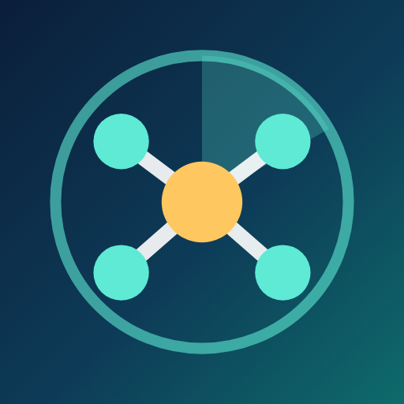

<p align="center">
  
</p>

<h1 align="center">OpenLAN Scanner</h1>

<p align="center">
  <b>The open source network scanner for Android.</b><br>
  See who is on your Wi-Fi: devices, names, vendors, open ports, live ping and traceroute.<br>
  No account. No cloud. No tracking. All the code is here.
</p>

<p align="center">
  <a href="LICENSE"></a>
  
  
  
</p>

---

🇮🇹 [Leggi in italiano](#-italiano)

## Features

- **Device discovery** – ping sweep + TCP probe of the whole subnet (up to /22).
- **Names and identity** – NetBIOS, mDNS/Bonjour, SSDP/UPnP and reverse DNS.
- **MAC addresses without ARP** – Android 10+ blocks the ARP table, so MACs are taken from what devices announce (NetBIOS, mDNS, UPnP) and the source is always shown.
- **Vendor lookup** – offline IEEE OUI database (~58,000 entries).
- **Device type** – router, PC, phone, printer, TV, NAS, server, camera, IoT…
- **Roles** – highlights *this device*, gateway, DNS and DHCP servers.
- **History** – devices are remembered per network; online/offline at a glance.
- **Port scan** – common ports or 1–1024, then open the service with one tap (browser, SSH, SMB, RDP, VNC, RTSP…).
- **Live ping chart** – one ping per second with min/avg/max/loss.
- **Traceroute** – find where your LAN ends, detect CGNAT, see the first public hop.
- **Diagnostics** – a raw log of every protocol, useful to report problems.
- English and Italian, light and dark theme.

## Privacy

OpenLAN Scanner works **only on your local network** and keeps its data **only on your phone**.
Nothing is uploaded, there are no analytics and no account. See [PRIVACY.md](PRIVACY.md).

The location permission is required by Android only to read the Wi-Fi name (SSID). The app never reads your position.

## Two flavors, same code

| Flavor | Where | Ads | Google libraries |
|---|---|---|---|
| `foss` | build it yourself, F-Droid | **none** | **none** |
| `play` | Google Play | one small banner in the device page (AdMob, with GDPR consent) | AdMob + UMP |

The ad code lives only in [`app/src/play`](app/src/play); the `foss` flavor replaces it with an empty stub.

## Build

Requirements: Android Studio (or JDK 17 + Android SDK 36).

```bash
git clone https://github.com/drcrck/openlan-scanner.git
cd openlan-scanner
./gradlew assembleFossDebug          # APK without ads → app/build/outputs/apk/foss/debug/
./gradlew testFossDebugUnitTest      # unit tests
```

Release builds (optional):

- copy `keystore.properties.example` → `keystore.properties` and point it to your keystore;
- for the `play` flavor copy `ads.properties.example` → `ads.properties` with your AdMob IDs
  (without it, Google's official test IDs are used).

```bash
./gradlew bundlePlayRelease          # AAB for Google Play
./gradlew assembleFossRelease        # signed APK without ads
```

## How it works

| Step | Technique |
|---|---|
| Find hosts | `ping` + TCP connect on common ports (a refused connection also means "alive") |
| Windows/Samba names + MAC | NetBIOS NBSTAT (UDP 137) |
| Apple, Linux, printers, Chromecast… | mDNS unicast + multicast listener (UDP 5353) |
| Smart TVs, NAS, routers | SSDP M-SEARCH + UPnP description XML |
| Hostnames | PTR queries sent directly to the network's DNS servers |
| Device recognition across scans | MAC → UPnP UDN → NetBIOS → mDNS → DNS name → IP |

Project structure:

```
app/src/main/java/io/github/drcrck/openlan/
├── scanner/      discovery protocols, classifier, ping, traceroute, port scanner
├── data/         Room database, network info, OUI lookup, device matching
└── ui/           Jetpack Compose screens
```

## Contributing

Issues and pull requests are welcome! Good first contributions:

- new device classification rules (`scanner/DeviceClassifier.kt`) – please add a test;
- translations (`app/src/main/res/values-xx/strings.xml`);
- diagnostics from networks where something is not detected (open the bug icon → share).

## License

Copyright © 2026 Diego Rigoni

This program is free software: you can redistribute it and/or modify it under the terms of the
**GNU General Public License v3.0 or later**. See [LICENSE](LICENSE).

Third-party data: vendor names from the IEEE registry via the Wireshark `manuf` file;
fonts Space Grotesk and JetBrains Mono under the SIL Open Font License.

---

## 🇮🇹 Italiano

**OpenLAN Scanner** è uno scanner di rete per Android, **completamente open source**.
Mostra chi è collegato alla tua rete: dispositivi, nomi, produttori, porte aperte, ping in tempo reale e traceroute.
Nessun account, nessun cloud, nessun tracciamento: tutto il codice è qui.

- **Versione `foss`**: compilata dai sorgenti, **senza pubblicità** e senza librerie Google.
- **Versione `play`**: quella su Google Play, con un solo piccolo banner nella scheda del dispositivo per sostenere lo sviluppo.

Per compilare: `./gradlew assembleFossDebug`. Segnalazioni e proposte sono benvenute nelle
[Issues](https://github.com/drcrck/openlan-scanner/issues).
